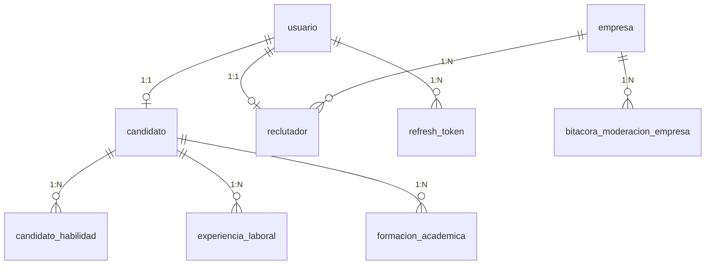
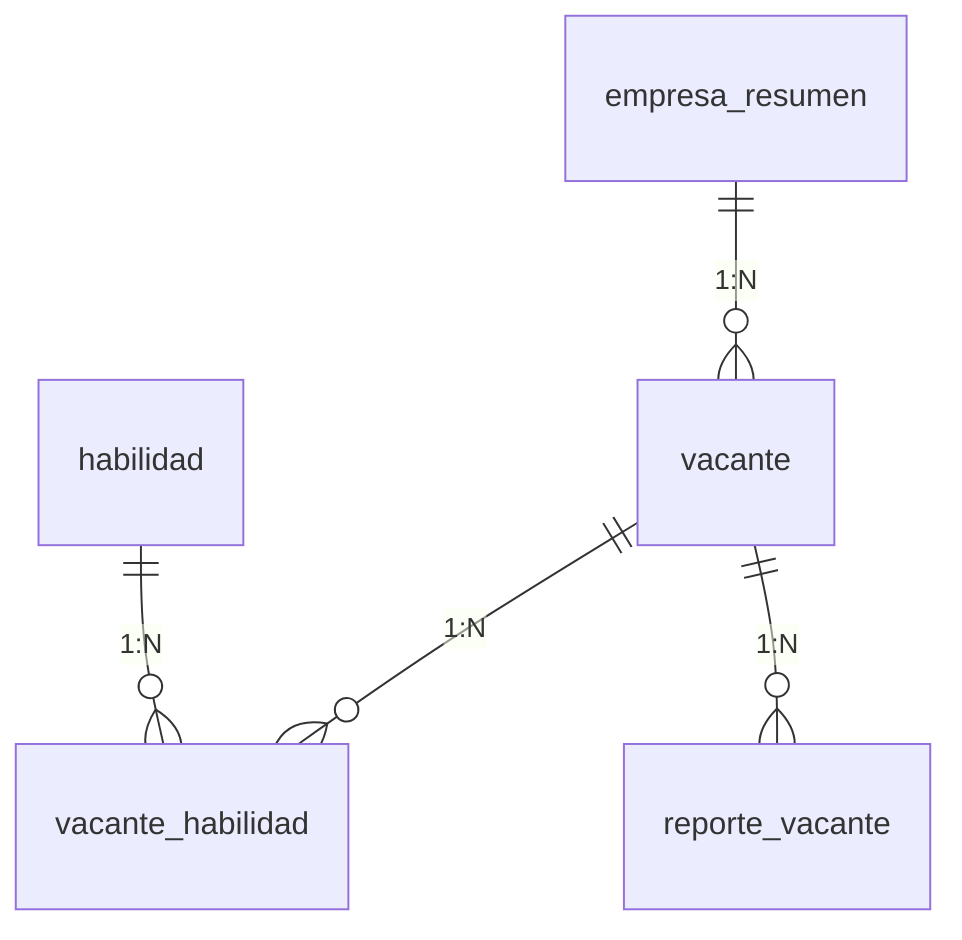
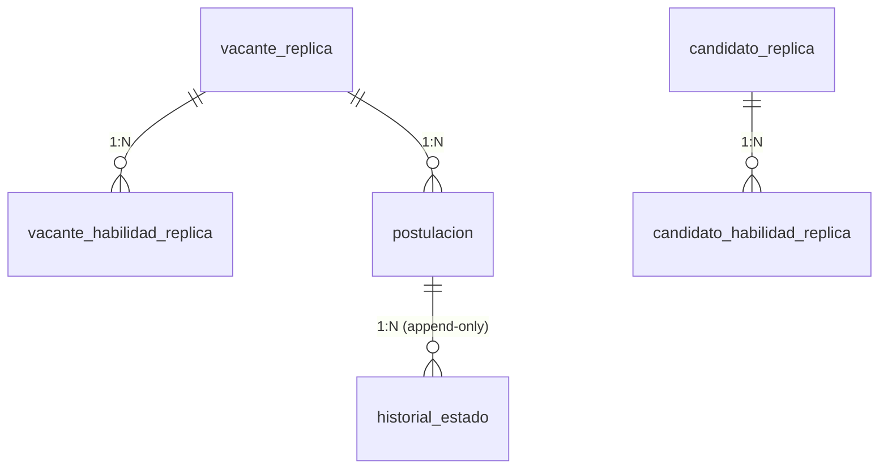

# 01 — Diagrama Entidad-Relación Lógico y Físico (`NexTalentDb`)

**Proyecto:** NexTalent (`angelmontws/nextalent`) · Equipo Gustambitos (UPIICSA — IPN)  
**Motor:** Microsoft SQL Server 2025 · Base única `NexTalentDb` con 5 esquemas aislados (`identidad`, `vacantes`, `postulaciones`, `notificaciones`, `HangFire`).  
**Principio rector:** Cero llaves foráneas (`FOREIGN KEY`) entre esquemas. Cada microservicio posee su propia tabla `<esquema>.__EFMigrationsHistory` y sincroniza réplicas ligeras mediante eventos en RabbitMQ respaldados por MassTransit Transactional Outbox.

---

## 1. Vista Lógica Global y Sincronización por Eventos

```mermaid
flowchart LR
    subgraph ID["[identidad]"]
        U["usuario / refresh_token"]
        C["candidato + exp / form / cand_hab"]
        E["empresa / reclutador / bitacora_empresa"]
    end

    subgraph VA["[vacantes]"]
        ER["empresa_resumen (réplica)"]
        V["vacante + vacante_habilidad"]
        H["habilidad (catálogo)"]
        MOD["reporte_vacante / bitacora_moderacion"]
    end

    subgraph PO["[postulaciones]"]
        VR["vacante_replica + hab_replica"]
        CR["candidato_replica + hab_replica"]
        P["postulacion (folio_seq)"]
        HE["historial_estado (inmutable)"]
    end

    subgraph NO["[notificaciones] + [HangFire]"]
        CTR["contacto_replica"]
        CW["codigo_whatsapp / mensaje_procesado"]
        PS["postulacion_seguimiento (RN-04 10d)"]
        N["notificacion / alerta_vacante_enviada"]
    end

    ID -- "EmpresaVerificada" --> VA
    ID -- "EmpresaVerificada / ContactoActualizado" --> NO
    ID -- "PerfilHabilidadesActualizado" --> PO
    VA -- "VacantePublicada / VacanteCerrada" --> PO
    VA -- "VacanteCerrada" --> NO
    PO -- "PostulacionCreada / EstatusCambiado" --> NO
    NO -- "ConsentimientoWhatsappCambiado" --> ID
```

---

## 2. Modelo Físico por Esquema

### 2.1 Esquema `[identidad]`

### 2.2 Esquema `[vacantes]`

* Además incluye `vacantes.bitacora_moderacion` (inmutable) y las tablas `InboxState`, `OutboxMessage` y `OutboxState` de MassTransit.

### 2.3 Esquema `[postulaciones]`

* Además incluye la secuencia `postulaciones.folio_seq`, las tablas `InboxState`, `OutboxMessage` y `OutboxState`, y las vistas `vw_ConteoPostulacionesEmpresa` y `vw_IndiceRespuestaEmpresa`.
* *Nota de alcance:* `documento_postulacion` (`NT-026` a `NT-029`) se incorpora en migración incremental posterior conforme a los acuerdos del 26 de noviembre de 2026.

### 2.4 Esquema `[notificaciones]` y `[HangFire]`

* `notificaciones.contacto_replica`: réplica local de correo, teléfono WhatsApp, BSUID y consentimiento opt-in.
* `notificaciones.codigo_whatsapp`: estado y hash HMAC-SHA256 de códigos OTP de 6 dígitos (vigencia 10 min, bloqueo 15 min tras 5 fallos).
* `notificaciones.mensaje_whatsapp_procesado`: idempotencia de webhooks de Meta.
* `notificaciones.postulacion_seguimiento`: control de postulaciones activas para el recordatorio de 10 días hábiles (RN-04).
* `notificaciones.notificacion`: bitácora de envíos y cola de reintentos exponenciales (1, 5 y 15 min + respaldo por correo) sin duplicar texto personal.
* `notificaciones.alerta_vacante_enviada`: control de no repetición en alertas `P-01` y mapeo botón-vacante.
* `notificaciones.InboxState` / `OutboxMessage` / `OutboxState`: atomicidad transaccional MassTransit (RNF-09).
* `[HangFire].*`: tablas operativas aisladas para tareas recurrentes.
