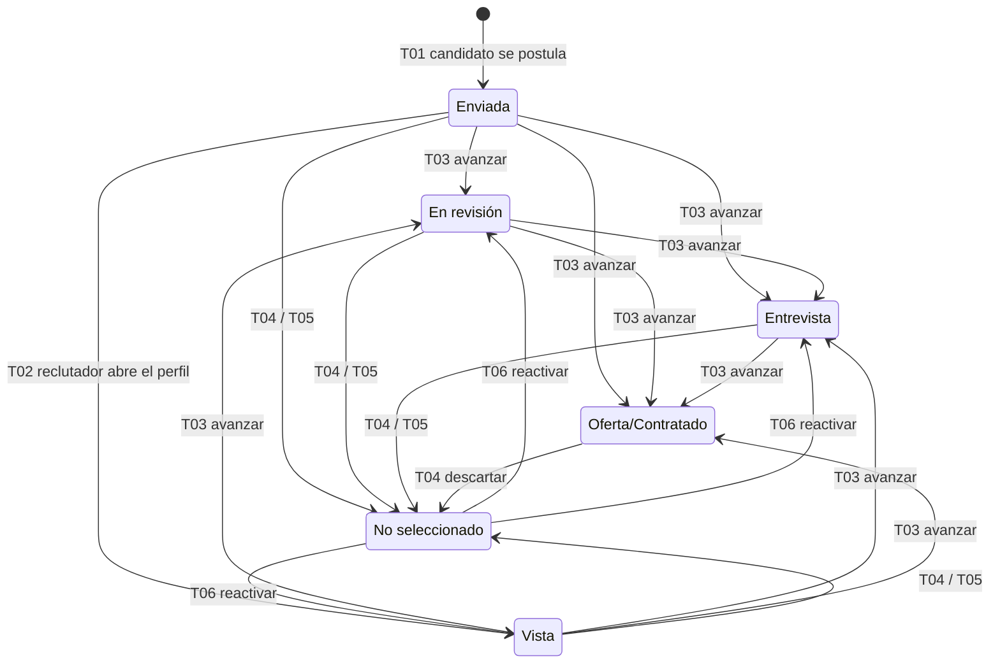

# Máquina de estados de la postulación (tarea 1.1)

| | |
|---|---|
| **Responsable** | Backend 2 |
| **Fase** | 1 - Diseño |
| **Historias** | HU-05.01 a HU-05.04, HU-06.01 a HU-06.03 |
| **Fuentes** | Documento v5 (D-01, D-02, secciones 1.2.5, 1.2.6, 1.4.4 y 1.5) y `tools/backlog/backlog.csv` |
| **Estado** | Propuesta, pendiente de acordar las decisiones de la sección 8 |

**[F]** = regla tomada de las fuentes. **[P]** = propuesta de Backend 2, porque las fuentes no lo definen o se contradicen.

## 1. Estados

| Estado | Tipo | ¿Pendiente al cerrar la vacante? | Filtro de "Mis postulaciones" [P] |
|---|---|---|---|
| Enviada | Avance, inicial | Sí [P] | Activa |
| Vista | Avance | Sí [P] | Activa |
| En revisión | Avance | Sí [P] | Activa |
| Entrevista | Avance | Sí [P] | Activa |
| Oferta/Contratado | Avance, último | No [P] | Cerrada |
| No seleccionado | Cierre | No [P] | Cerrada |

Los seis estados son [F]. Las fuentes hablan de "pendientes" sin listar cuáles.

## 2. Diagrama

T04 es un descarte del reclutador; T05, el cierre de la vacante.

## 3. Transiciones

| ID | Transición | Quién la provoca | Condiciones | Origen |
|---|---|---|---|---|
| T01 | (nueva) → Enviada | Candidato | Perfil mínimo, vacante abierta, sin duplicado | [F] HU-05.01 |
| T02 | Enviada → Vista | Sistema, cuando el reclutador abre el perfil | Vacante de su empresa. En otro estado no hace nada | [F] HU-06.01 |
| T03 | Avance a una etapa posterior | Reclutador | Vacante abierta y de su empresa | [F] avanzar; [P] permitir saltos y exigir vacante abierta |
| T04 | Cualquier avance → No seleccionado | Reclutador | Vacante de su empresa | [F] v5, sección 2.3 |
| T05 | Pendiente → No seleccionado | Sistema, al consumir `VacanteCerrada` | Estado pendiente | [F] HU-05.03 |
| T06 | No seleccionado → Vista, En revisión o Entrevista | Reclutador | Confirmación y motivo [F]; vacante abierta y destinos [P] | HU-06.02 |

**No se permite [P]:** volver a Enviada, retroceder entre etapas de avance, pasar directamente de No seleccionado a Oferta/Contratado ni "mover" al mismo estado.

Mover a mano de Enviada a Vista en el tablero se trata igual que T02 [P].

### Matriz

Filas: estado actual. Columnas: destino. Guion: no permitido.

| | Enviada | Vista | En revisión | Entrevista | Oferta/Contratado | No seleccionado |
|---|---|---|---|---|---|---|
| **Enviada** | - | T02 | T03 | T03 | T03 | T04, T05 |
| **Vista** | - | - | T03 | T03 | T03 | T04, T05 |
| **En revisión** | - | - | - | T03 | T03 | T04, T05 |
| **Entrevista** | - | - | - | - | T03 | T04, T05 |
| **Oferta/Contratado** | - | - | - | - | - | T04 |
| **No seleccionado** | - | T06 | T06 | T06 | - | - |

## 4. Permisos

Según la matriz de roles del v5 (sección 1.5) [F]:

| Rol | Puede |
|---|---|
| Candidato | Postularse (T01) y consultar lo suyo. No cambia etapas |
| Reclutador | T03, T04 y T06, y provocar T02, solo en vacantes de su empresa |
| Administrador | Ninguna transición |
| Sistema | T02 y T05 |

Las fuentes no contemplan que el candidato retire su postulación; no se agrega.

## 5. Qué ocurre en cada transición

En una sola transacción de base de datos:

1. Se valida la transición en `Domain`.
2. Se actualiza `estado_actual`.
3. Se inserta una fila en `historial_estado`.
4. Se guarda el evento en la Outbox.

| Transición | Evento | `cambiado_por` [P] | `motivo` |
|---|---|---|---|
| T01 | `PostulacionCreada` [F] | Candidato | Vacío |
| T02 | `EstatusCambiado` | Reclutador que abrió el perfil | Vacío |
| T03 | `EstatusCambiado` | Reclutador | Opcional [P] |
| T04 | `EstatusCambiado` | Reclutador | Opcional [P] |
| T05 | `EstatusCambiado` [F] | Sistema | Causa del cierre, si el evento la trae [P] |
| T06 | `EstatusCambiado` | Reclutador | **Obligatorio** [F] |

- T01 también escribe la primera fila del historial, con `estado_anterior` vacío, para mostrar la fecha de Enviada [P].
- El aviso de No seleccionado incluye un enlace a vacantes similares [F].
- T03, T04, T05 y T06 notifican al candidato. HU-07.04 pide avisar "cada cambio de etapa", lo que incluye T02 (decisión 5).

## 6. Recordatorio de 10 días hábiles

**No es una transición**: avisa al reclutador y no cambia el estado [F].

- El plazo empieza en el último cambio de estado y se reinicia con cada uno [P]. Por eso T02 lo reinicia.
- Aplica a los cuatro estados pendientes [P]. HU-05.03 no limita la etapa, aunque D-01 solo dibuja el recordatorio desde Enviada.
- Lo ejecuta Hangfire en Notificaciones, que no puede leer el esquema `postulaciones`. Necesita su propia copia del último cambio, alimentada por `PostulacionCreada` y `EstatusCambiado` [P].

## 7. Errores y casos límite

| Caso | Comportamiento propuesto [P] |
|---|---|
| Transición no permitida | 409 |
| T06 sin motivo | 400 |
| Rol o empresa equivocados | 403 [F] |
| Postulación inexistente | 404 |
| Postulación duplicada | 409 "Ya te postulaste" [F: HU-05.01 y plan] |
| Dos reclutadores mueven a la vez | Control de concurrencia optimista; quien llega después recibe 409 |
| `VacanteCerrada` repetido | Las que ya no están pendientes se ignoran, sin otro historial ni aviso |
| Cierre y movimiento simultáneos | La concurrencia hace reintentar el cierre con el estado nuevo |
| Postulación creada durante el cierre | Postulaciones recuerda qué vacantes cerraron y lo valida al crear, para no dejar una pendiente huérfana |
| Acción masiva con casos inválidos | Se valida cada una y se devuelve el resultado individual |
| Vacante oculta por reportes | No es cierre: no dispara T05. Solo lo hace `VacanteCerrada` [F: D-02] |

## 8. Decisiones por acordar

| # | Pregunta | Propuesta | Con quién |
|---|---|---|---|
| 1 | ¿Se pueden saltar etapas? D-01 dibuja pasos seguidos; HU-06.02 dice "otra etapa" | Sí, hacia adelante | Equipo, Frontend |
| 2 | ¿Se puede retroceder entre etapas de avance? HU-06.02, leída literalmente, lo permite | No; si se acepta, con motivo como T06 | Equipo, Frontend |
| 3 | ¿Se descarta desde Oferta/Contratado? El v5 dice "cualquier etapa"; D-01 no lo dibuja | Sí. Ese estado mezcla oferta y contratación | Equipo |
| 4 | ¿Entrevista cuenta como pendiente al caducar? Cerraría un proceso vivo | Sí, para cumplir el 100% de respuesta; el recordatorio del día 27 permite renovar | Equipo, Backend 1 |
| 5 | ¿Vista avisa por WhatsApp? Cumple HU-07.04, pero agrega mensajes y costo | Avisar todo, como pide la historia, salvo acuerdo distinto | Equipo |
| 6 | ¿Se reactiva con la vacante cerrada? | No; primero se reabre, si Vacantes lo permite | Backend 1 |
| 7 | ¿Reactivar directo a Oferta/Contratado? | No | Equipo |
| 8 | ¿Se repite el recordatorio y se cuentan festivos? | Una vez por etapa; calendario de festivos por definir | Equipo |
| 9 | ¿Qué cuenta como "respuesta" en el índice? | Sin propuesta: las fuentes no lo definen | Equipo, Base de Datos |
| 10 | ¿`VacanteCerrada` incluye la causa? | Sí: manual, caducidad o moderación | Backend 1 |
| 11 | ¿Cómo se guarda "sistema" en `cambiado_por` y dónde va la versión de concurrencia? | Valor reservado y columna de versión | Base de Datos |
| 12 | ¿El candidato ve el motivo de T04 y T06? | Sin propuesta: depende de mockups | Frontend |

## 9. Pruebas previstas (tarea 2.1)

1. Las 36 combinaciones de la matriz, permitidas y no permitidas, según quién las provoca.
2. T02 no cambia nada si el estado no es Enviada.
3. T05 solo afecta estados pendientes y es idempotente.
4. T06 falla sin motivo o con la vacante cerrada.
5. Cada transición válida genera exactamente un registro de historial y un evento.
6. Una transición inválida no modifica estado, historial ni eventos.

Los puntos que cambien en la sección 8 cambian también estas pruebas.
